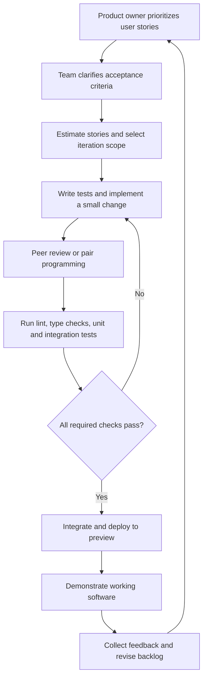

# GTA Legend Lane: Extreme Programming Development Roadmap and User Story Specification

## 1. Project Overview

**GTA Legend Lane** is a catalogue and discovery website for GTA Online services and accounts. Visitors can browse categories, review product/service details and prices, select a preferred display currency, and initiate an order by contacting the seller through Discord or Telegram.

The website is a storefront and order-intent handoff, not a checkout platform. Customers must see prices on the website, but they do not pay on the website. An order button prepares the relevant product or service details and redirects the customer to the configured contact channel.

### 1.1 Core Product Rules

- **USD is the authoritative base currency.** Every product or service price is stored and maintained in USD.
- **Local currency is a display conversion.** The site attempts to detect the visitor's country and show an equivalent price in the likely local currency.
- **Visitors can select a currency manually.** A manual selection takes precedence over automatic detection for display purposes.
- **Converted amounts are indicative.** USD remains the source of truth; the site must not present a converted amount as a separately maintained authoritative price.
- **Graceful fallback is required.** If country detection or exchange-rate lookup fails, the site displays USD prices.
- **Both fixed and variable pricing are supported.** Some offers use defined packages; others require a price range, starting price, or configurable details managed by the administrator.
- **No on-site checkout or payment processing.** Orders are initiated through configured Discord or Telegram contact links.
- **Services and prices must be admin-managed.** Do not invent or hard-code real product claims, service features, prices, reviews, or availability.
- **Initial configurable categories:** modded accounts, money drops, boosting, and other GTA services. Administrators must be able to create, edit, reorder, and disable categories.

### 1.2 Project Reference

Reference design: https://gta-legend-lane.lovable.app

Use the reference as a source of product direction and visual inspiration. Inspect its actual content and behavior before implementation; do not assume that every detail is final or copy unsupported claims.

## 2. Development Approach: Extreme Programming (XP)

The project should be developed using Extreme Programming practices. XP is useful here because it encourages short feedback loops, small releases, continuous testing, and close collaboration between the product owner and developers.

### 2.1 XP Principles for This Project

1. **Small releases:** deliver a usable increment at the end of each iteration.
2. **User stories:** plan work around outcomes a visitor or administrator needs.
3. **Simple design:** implement only what is needed for the current agreed scope while leaving the system easy to extend.
4. **Test-first development:** write or define acceptance tests before, or alongside, implementation.
5. **Continuous integration:** merge and validate changes frequently.
6. **Refactoring:** improve code structure without changing externally visible behavior.
7. **Collective ownership:** code should be understandable and maintainable by the team.
8. **Pairing and review:** use pair programming or peer review for critical features.
9. **Sustainable pace:** keep iterations realistic and do not trade away essential quality checks to meet a date.
10. **Frequent stakeholder feedback:** demonstrate working software and confirm assumptions early.

### 2.2 Priority Definitions

- **P0 — Must have:** required for a safe, usable initial release.
- **P1 — Should have:** important for the launch experience; schedule after P0 if capacity is constrained.
- **P2 — Could have:** useful enhancement that can be deferred without blocking launch.

## 3. Personas and Main User Journeys

### 3.1 Customer / Visitor

A customer wants to find a relevant GTA Online service, understand its price and requirements, and contact the seller without completing a website checkout.

Main journey:

1. Open the homepage.
2. Browse a category or view featured listings.
3. Search or filter the catalogue if needed.
4. Open a listing and review its details, package options, pricing, and availability.
5. Choose a display currency or accept the detected currency.
6. Select the relevant package or provide the required order details.
7. Review a prepared order summary.
8. Continue to Discord or Telegram.
9. If a contact destination cannot be opened, use a visible fallback link or copy the order summary.

### 3.2 Administrator

An administrator needs to manage the storefront without editing application code.

Main journey:

1. Sign in securely.
2. Create or update a category.
3. Create or update a product/service listing.
4. Set its USD base price and pricing model.
5. Manage package options, required customer selections, availability, images, and display order.
6. Configure Discord and Telegram contact destinations.
7. Update homepage content and basic site information.
8. Preview changes and publish them.
9. Verify that customer-facing pages display the updated information correctly.

## 4. Scope and Non-Goals

### 4.1 Included in Version One

- Responsive public storefront.
- Homepage, category pages, catalogue, listing details, search, and basic filters.
- Admin-managed products, categories, packages, variable pricing, availability, and content.
- USD-authoritative pricing.
- Country-based currency suggestion and manually selectable display currency.
- Exchange-rate conversion with a clear fallback to USD.
- Order summary generation and contact handoff to Discord or Telegram.
- Basic policy, FAQ, contact, and SEO content.
- Authentication and protected administration.
- Automated tests, deployment, and basic monitoring.

### 4.2 Explicitly Excluded from Version One

- Website checkout, payment collection, escrow, or payment processing.
- Customer wallet, balance, or transaction ledger.
- Automatic fulfilment of GTA services.
- A customer account system unless later approved as a separate story.
- Claims about service delivery, account properties, stock, reviews, or guarantees that have not been supplied and verified.
- Automatic conversion of a displayed local-currency amount into a second authoritative price.
- Any payment provider integration.
- Any third-party service or licence not approved by the product owner.

## 5. User Stories and Acceptance Criteria

Each story should be implemented in small increments. Acceptance criteria are the minimum conditions for considering a story complete. The team should turn the criteria into executable tests where practical.

## Epic A: Foundation and Engineering Workflow

### GL-001 — Initialize the application

**Priority:** P0

**User story:** As a developer, I want a consistent application foundation so that the team can implement and maintain the storefront reliably.

**Acceptance criteria:**
- The application runs locally using documented commands.
- The repository has a clear source structure and environment configuration.
- Required scripts exist for development, build, linting, type checking, and tests.
- Secrets are not committed to source control.
- A README explains setup, environment variables, and the main development commands.
- The application can be built successfully in a clean environment.

### GL-002 — Establish automated quality checks

**Priority:** P0

**User story:** As a developer, I want automated checks to run on changes so that regressions are caught before deployment.

**Acceptance criteria:**
- Linting and type checking run through documented commands.
- Unit tests can run in the local environment.
- Continuous integration runs the agreed checks for pull requests or pushes.
- A failing required check is visible and prevents the affected change from being treated as ready to merge.
- The team documents how to reproduce a failed check locally.

### GL-003 — Separate environments and configuration

**Priority:** P0

**User story:** As an administrator/developer, I want environment-specific configuration so that local, preview, and production deployments use the correct settings.

**Acceptance criteria:**
- Local, preview, and production configuration can be managed separately.
- Database URLs, authentication secrets, contact destinations, storage settings, and external API keys are environment variables or managed secrets.
- Missing required production configuration causes a clear startup or deployment error.
- No private secret is exposed to browser-side code.
- The documented deployment process identifies the configuration required in each environment.

## Epic B: Design System and Shared Layout

### GL-004 — Create the reusable design system

**Priority:** P0

**User story:** As a visitor, I want a consistent and readable interface so that the website feels coherent across pages and devices.

**Acceptance criteria:**
- The project defines reusable typography, spacing, color, border, button, input, card, and feedback styles.
- Common interface elements are implemented as reusable components where appropriate.
- Interactive states include hover, focus, disabled, loading, and error states where relevant.
- Text and controls remain readable at supported viewport sizes.
- Keyboard focus is visible.
- The design system is documented sufficiently for the team to use it consistently.

### GL-005 — Implement shared navigation and footer

**Priority:** P0

**User story:** As a visitor, I want clear navigation so that I can move between the homepage, categories, catalogue, policies, and contact options.

**Acceptance criteria:**
- The shared header and footer are present on the relevant public pages.
- Navigation links lead to valid destinations.
- The active or current section is clear where appropriate.
- Mobile navigation is usable with touch and keyboard.
- Discord and Telegram contact links appear only when configured.
- Broken or placeholder links are not shown as working links.

## Epic C: Homepage and Discovery

### GL-006 — Build the homepage

**Priority:** P0

**User story:** As a visitor, I want a useful homepage that explains the storefront and helps me discover available services.

**Acceptance criteria:**
- The homepage communicates the site purpose without unsupported promises.
- It provides clear paths to browse categories and the catalogue.
- Featured content can be managed through the admin interface or a documented initial content source.
- The layout works on mobile, tablet, and desktop.
- Empty or missing featured content does not break the page.
- Calls to action lead to real catalogue or contact destinations.

### GL-007 — Browse service categories

**Priority:** P0

**User story:** As a visitor, I want to browse services by category so that I can narrow my search to the type of GTA service I need.

**Acceptance criteria:**
- Active categories are visible on the relevant discovery pages.
- Selecting a category opens its catalogue view.
- Disabled categories are not presented as available categories to customers.
- Category names, descriptions, images, and display order are managed in the admin area.
- Empty categories have a useful empty state.
- Category pages have meaningful page titles and metadata.

### GL-008 — View featured listings

**Priority:** P1

**User story:** As a visitor, I want to see selected listings on the homepage so that I can discover highlighted offers quickly.

**Acceptance criteria:**
- Administrators can mark eligible listings as featured.
- Featured listings display the listing name, image when available, pricing summary, and a route to details.
- Only active and available-to-display listings appear.
- The homepage handles the case where no listings are featured.
- Featured order can be managed or follows a documented predictable rule.

## Epic D: Catalogue and Listing Details

### GL-009 — Browse the catalogue

**Priority:** P0

**User story:** As a visitor, I want to see a catalogue of active services so that I can compare available options.

**Acceptance criteria:**
- The catalogue displays active listings only.
- Each listing card shows the information needed to identify the offer and understand its price model.
- Listing cards link to their detail pages.
- Empty and loading states are handled.
- The layout remains usable on mobile and desktop.
- Unavailable listings are clearly labelled or excluded according to the agreed storefront rule.

### GL-010 — View a listing's details

**Priority:** P0

**User story:** As a visitor, I want a dedicated listing page so that I can understand the offer before contacting the seller.

**Acceptance criteria:**
- The page displays the listing title, description, category, images when available, price information, package choices or variable-price guidance, and availability.
- Required customer selections or order notes are clearly described.
- The page does not invent product attributes or service guarantees.
- The visitor can initiate the configured order/contact flow from the page.
- Missing optional images or descriptions do not break the page.
- The page has an appropriate title, description metadata, and canonical URL where applicable.

### GL-011 — Search and filter listings

**Priority:** P1

**User story:** As a visitor, I want to search and filter the catalogue so that I can find a relevant listing more quickly.

**Acceptance criteria:**
- Visitors can search by listing name and agreed searchable text fields.
- Visitors can filter by category and availability where applicable.
- Search and filters can be combined.
- The UI communicates when no results match.
- Clearing filters restores the broader result set.
- Search and filter behavior is usable on mobile.
- Input is validated and does not produce database errors or unsafe query construction.

## Epic E: Pricing and Currency Display

### GL-012 — Store USD as the authoritative base price

**Priority:** P0

**User story:** As an administrator, I want all prices stored in USD so that there is one authoritative source for pricing.

**Acceptance criteria:**
- Every priced listing or package stores its base amount in USD.
- Variable-price listings store the agreed USD pricing fields, such as a starting amount, range, or quote-required flag.
- The application distinguishes a missing price from a genuine zero price.
- Customer-facing prices are derived from the stored USD amount and current display-currency settings.
- The admin interface makes it clear that USD is the authoritative price.
- Currency calculations use appropriate decimal handling and rounding rules.

### GL-013 — Suggest currency based on visitor country

**Priority:** P0

**User story:** As a visitor, I want the site to suggest a local display currency based on my country so that prices are easier for me to understand.

**Acceptance criteria:**
- The site attempts country detection using the agreed geolocation mechanism.
- The detected country is mapped to a configured display currency.
- Detection failure, missing country data, or an unsupported country does not break the page.
- The site falls back to USD when a safe display currency cannot be determined.
- Country detection does not change the authoritative USD price.
- The detection method and any privacy implications are documented.

### GL-014 — Convert USD prices for display

**Priority:** P0

**User story:** As a visitor, I want to see an indicative local-currency equivalent so that I can estimate the cost in a familiar currency.

**Acceptance criteria:**
- The application retrieves exchange rates from the selected approved source or uses administrator-managed rates.
- Conversion is calculated from the USD base amount.
- The UI identifies the displayed currency and communicates that local amounts are indicative.
- The application records or exposes the rate timestamp/source as appropriate to the chosen design.
- Rate lookup failure or stale/unusable data triggers the agreed fallback to USD.
- Exchange rates are cached or otherwise handled to avoid unnecessary repeated requests.
- Conversion logic has tests for rounding, missing rates, invalid rates, and fallback behavior.

### GL-015 — Allow manual currency selection

**Priority:** P0

**User story:** As a visitor, I want to choose my preferred display currency so that I can override automatic currency detection.

**Acceptance criteria:**
- A currency selector shows the supported display currencies.
- Selecting a currency updates visible prices without changing the USD base prices.
- The manual choice takes precedence over automatic country detection for the active browsing session or agreed persistence period.
- Unsupported or unavailable conversion currencies are not selectable as if they were working.
- If the selected currency's rate is unavailable, the site follows the defined fallback behavior and communicates it clearly.
- The selector is accessible by keyboard and on mobile.

### GL-016 — Support fixed-price packages

**Priority:** P0

**User story:** As an administrator, I want to define fixed-price packages so that customers can choose among clearly priced offers.

**Acceptance criteria:**
- A listing can have one or more named packages.
- Each package has a USD base price and any required description or included-option details.
- Packages can be created, edited, reordered, activated, or disabled.
- The customer can select an active package on the listing page.
- The selected package and price appear in the order summary.
- Disabled packages cannot be selected for a new order.
- Package pricing uses the same display-currency conversion rules as other prices.

### GL-017 — Support variable-price services

**Priority:** P0

**User story:** As an administrator, I want to configure variable-price services so that listings that cannot be represented by one fixed package can still be presented accurately.

**Acceptance criteria:**
- A listing can use an agreed variable pricing mode, such as “starting at,” a USD range, or “contact for quote.”
- The administrator can configure the fields appropriate to the selected mode.
- The customer-facing page labels the pricing model clearly.
- Any numeric amount shown is derived from the stored USD value or values.
- A quote-required listing does not display a fabricated price.
- The generated order summary includes the selected service and relevant customer-provided details.
- Invalid combinations of variable-price fields are rejected by validation.

## Epic F: Order Intent and Contact Handoff

### GL-018 — Configure contact channels

**Priority:** P0

**User story:** As an administrator, I want to configure Discord and Telegram destinations so that order buttons direct customers to the correct contact point.

**Acceptance criteria:**
- Authorized administrators can configure the supported contact URLs or identifiers.
- URLs are validated against the permitted destination rules.
- A missing channel is treated as unavailable and is not rendered as a broken action.
- The application does not expose secret tokens or bot credentials to the browser.
- Changes to contact destinations are reflected in the customer-facing site.
- The system has a clear fallback when neither channel is configured.

### GL-019 — Prepare an order summary

**Priority:** P0

**User story:** As a customer, I want a prepared summary of my selected listing and options so that I can communicate my intended order clearly.

**Acceptance criteria:**
- The summary includes the listing name and a stable listing reference where available.
- It includes the selected package, configuration choices, and customer-entered notes where applicable.
- It identifies the USD base price and, if displayed, the indicative local-currency amount.
- It does not claim that an order has been placed, paid for, or fulfilled.
- User-entered text is safely handled and length-limited.
- The customer can review the summary before continuing to a contact channel.
- If a listing requires a quote, the summary says that the price must be confirmed with the seller.

### GL-020 — Continue an order through Telegram

**Priority:** P0

**User story:** As a customer, I want to continue my order through Telegram so that I can contact the seller using that channel.

**Acceptance criteria:**
- The Telegram action is available only when a valid Telegram destination is configured.
- The action opens the configured destination using an appropriate navigation method.
- Where supported, the order summary is prepared for the customer to copy or send; the site does not claim to have sent a message unless it truly has.
- If prefilled message support is unavailable, a copyable summary is provided.
- The user is informed that the order conversation continues outside the website.
- The flow works on supported mobile and desktop browsers.

### GL-021 — Continue an order through Discord

**Priority:** P0

**User story:** As a customer, I want to continue my order through Discord so that I can contact the seller using that channel.

**Acceptance criteria:**
- The Discord action is available only when a valid Discord destination is configured.
- The action opens the configured destination using an appropriate navigation method.
- Where supported, the order summary is prepared for the customer to copy or send; the site does not claim to have sent a message unless it truly has.
- If prefilled message support is unavailable, a copyable summary is provided.
- The user is informed that the order conversation continues outside the website.
- The flow works on supported mobile and desktop browsers.

### GL-022 — Recover from contact handoff failures

**Priority:** P1

**User story:** As a customer, I want a fallback when a contact link cannot be opened so that I can still reach the seller.

**Acceptance criteria:**
- The page provides a clear fallback when a channel is unavailable or a redirect cannot be initiated.
- The order summary can be copied without losing the selected listing or options.
- A customer can return to the listing and change their selection.
- The interface does not claim that a message was delivered or an order was received.
- Errors are understandable and do not expose internal secrets or stack traces.

## Epic G: Administration

### GL-023 — Secure the admin area

**Priority:** P0

**User story:** As an authorized administrator, I want secure access to the management interface so that only permitted users can change the storefront.

**Acceptance criteria:**
- Admin routes and mutations require authentication.
- Unauthorized visitors cannot access protected admin data or actions.
- Passwords, if used, are stored using an appropriate password-hashing method; alternatively, the approved authentication provider is configured securely.
- Sessions use secure settings appropriate to the deployment.
- Login errors do not disclose whether a specific credential exists.
- The application includes logout and appropriate session expiry behavior.
- Administrative secrets are never exposed to client-side code.
- Authentication and authorization behavior is tested.

### GL-024 — Manage products and services

**Priority:** P0

**User story:** As an administrator, I want to create, read, update, and deactivate listings so that I can maintain the catalogue without developer intervention.

**Acceptance criteria:**
- Authorized administrators can create, edit, preview, activate, deactivate, and inspect listings.
- Listing fields include the agreed title, slug, description, category, images, pricing mode, price data, availability, and display metadata.
- Required fields are validated on both client and server.
- Slugs are unique and stable or changed through a controlled process.
- Deactivated listings are not presented as available for new orders.
- Deleting or deactivating a listing does not cause unrelated listings to break.
- Save success and failure are clearly communicated.
- Changes persist in the database and appear on the public site.

### GL-025 — Manage categories and platforms/tags

**Priority:** P0

**User story:** As an administrator, I want to manage categories and classification fields so that the catalogue can grow without code changes.

**Acceptance criteria:**
- Administrators can create, edit, reorder, activate, and deactivate categories.
- Listings can be assigned to an appropriate category.
- The system handles a category that still has associated listings according to a documented rule.
- The initial categories can include modded accounts, money drops, boosting, and other GTA services, but category content remains configurable.
- Any platform or tag field included in the agreed data model can be managed or selected consistently.
- Invalid category references are rejected.

### GL-026 — Manage listing availability

**Priority:** P0

**User story:** As an administrator, I want to control listing availability so that customers do not mistake unavailable offers for active offers.

**Acceptance criteria:**
- Administrators can set a listing to available, unavailable, or the agreed equivalent states.
- Availability is visible to customers according to the storefront rules.
- Unavailable listings cannot initiate a new order as if they were available.
- The admin interface distinguishes availability from publication/activation where both concepts exist.
- Availability changes are persisted and reflected on public pages.
- Availability behavior is covered by tests.

### GL-027 — Manage homepage content

**Priority:** P1

**User story:** As an administrator, I want to manage selected homepage content so that I can update the storefront without a code deployment.

**Acceptance criteria:**
- Agreed homepage fields such as headline, supporting copy, featured listings, and selected calls to action can be managed.
- Content fields have validation and safe length limits.
- Missing optional content falls back gracefully.
- Content is rendered safely without executing arbitrary scripts.
- Administrators can preview changes before publishing where the implementation supports draft/publish states.
- Published content appears on the public homepage.

## Epic H: Trust, Policies, SEO, and Reviews

### GL-028 — Publish policies and FAQs

**Priority:** P0

**User story:** As a visitor, I want clear policy and FAQ information so that I understand how contacting the seller and ordering works.

**Acceptance criteria:**
- The site provides configurable policy and FAQ content agreed with the product owner.
- Content explains that orders are completed through external contact channels and that the website does not process payments.
- The site does not make unsupported legal, refund, delivery, or guarantee claims.
- Policy and FAQ links are reachable from appropriate shared navigation or footer locations.
- Content is readable on mobile and desktop.
- Unpublished placeholder text is not shown as final policy.

### GL-029 — Implement basic SEO

**Priority:** P1

**User story:** As a site owner, I want search-engine-friendly pages so that listings and categories can be discovered through search.

**Acceptance criteria:**
- Public pages have unique, meaningful titles and meta descriptions where appropriate.
- Listing and category pages use clean, stable URLs.
- Canonical URLs are set where appropriate.
- Sitemap and robots directives are configured for the deployed site.
- Private admin pages are not intended for indexing.
- Images have appropriate alternative text when meaningful.
- Structured data is only added where accurate and supported by the actual page content.
- The implementation avoids generating indexable duplicate or empty pages unnecessarily.

### GL-030 — Display authentic reviews or testimonials

**Priority:** P1

**User story:** As a visitor, I want to read genuine customer feedback, when available, so that I can better evaluate the storefront.

**Acceptance criteria:**
- Reviews or testimonials are shown only when supplied and approved by the product owner.
- Administrators can add, edit, publish, and unpublish testimonial content if this feature is enabled.
- The system does not fabricate names, ratings, review counts, or customer statements.
- Unpublished testimonials are not visible publicly.
- If no verified reviews are available, the section is hidden or replaced with a neutral empty state.
- Any review attribution and permission requirements are confirmed before publication.

## Epic I: Quality, Security, Deployment, and Operations

### GL-031 — Add end-to-end tests for critical journeys

**Priority:** P0

**User story:** As a developer, I want automated end-to-end tests for critical customer and admin journeys so that core functionality remains reliable.

**Acceptance criteria:**
- Automated tests cover homepage and catalogue navigation.
- Tests cover listing details and fixed-package selection.
- Tests cover variable-price display and quote-required behavior.
- Tests cover USD pricing, currency selection, conversion, and fallback.
- Tests cover order summary generation and configured/unconfigured contact channels.
- Tests cover admin authentication and listing management.
- Tests run in a documented test environment and can be run locally or in CI.
- Test data does not depend on real customer information.

### GL-032 — Apply security and privacy safeguards

**Priority:** P0

**User story:** As the site owner, I want appropriate security and privacy controls so that the storefront and admin interface do not expose avoidable risks.

**Acceptance criteria:**
- Server-side input validation is implemented for all mutations.
- Database access uses safe query patterns or a properly configured ORM.
- Authentication and authorization are enforced server-side.
- Secrets are stored outside source control and are not returned to the browser.
- Rate limiting or equivalent abuse protection is applied to sensitive public endpoints where appropriate.
- Uploads, if supported, are validated for allowed file types and sizes.
- Output is escaped or safely rendered to prevent script injection.
- Dependencies are checked for known vulnerabilities through the agreed process.
- Production errors do not expose secrets, stack traces, or internal configuration.
- The privacy impact of geolocation/country detection is documented, and only necessary information is processed.

### GL-033 — Deploy the application

**Priority:** P0

**User story:** As the site owner, I want a repeatable deployment process so that the storefront can be released and updated reliably.

**Acceptance criteria:**
- The production deployment process is documented.
- Production environment variables and secrets are configured securely.
- Database migrations can be run in a controlled manner.
- The production build passes the required checks.
- The site uses HTTPS.
- A rollback or recovery approach is documented.
- A smoke test confirms that key public pages, currency display, and contact links work after deployment.
- No test credentials or placeholder content are left active in production.

### GL-034 — Monitor basic application health and failures

**Priority:** P1

**User story:** As the site owner, I want basic visibility into application health and failures so that I can identify and resolve issues after launch.

**Acceptance criteria:**
- The team can identify production build/runtime errors through an approved logging or monitoring mechanism.
- Sensitive data and secrets are excluded from logs.
- Critical public routes and the main order handoff flow can be checked after deployment.
- Exchange-rate or country-detection failures can be diagnosed without exposing personal data.
- The team has a documented process for reviewing and responding to reported issues.
- Monitoring configuration does not block the site from falling back gracefully when an external service fails.

## 6. Eight-Week Iteration Plan

The schedule is a planning baseline, not a substitute for estimating stories with the team. Review progress at the end of every iteration and adjust scope based on demonstrated capacity. Keep P0 functionality, tests, and security safeguards ahead of optional polish.

| Iteration | Focus | Planned stories |
|---|---|---|
| Week 1 | Project foundation | GL-001, GL-002, GL-003 |
| Week 2 | Design system and homepage foundation | GL-004, GL-005, GL-006 |
| Week 3 | Discovery and catalogue | GL-007, GL-008, GL-009, GL-010, GL-011 |
| Week 4 | Base pricing and currency display | GL-012, GL-013, GL-014, GL-015 |
| Week 5 | Pricing models | GL-016, GL-017 |
| Week 6 | Order intent and contact handoff | GL-018, GL-019, GL-020, GL-021, GL-022 |
| Week 7 | Administration | GL-023, GL-024, GL-025, GL-026, GL-027 |
| Week 8 | Trust, release quality, and launch | GL-028, GL-029, GL-030, GL-031, GL-032, GL-033, GL-034 |

**Capacity note:** This plan contains a substantial amount of work, especially in the final iterations. If the team cannot complete all stories within an iteration, move lower-priority work forward rather than skipping tests, security, or release verification. Re-estimate based on the team's actual velocity after the first two iterations.

## 7. XP Workflow

### 7.1 Suggested Daily Workflow

1. Review the current iteration goal and story acceptance criteria.
2. Select a small, testable task.
3. Write or update the relevant tests.
4. Implement the smallest working change.
5. Run local checks before opening or updating a pull request.
6. Review the change with another developer where practical.
7. Integrate frequently and resolve conflicts early.
8. Update the story status and record blockers.
9. Demonstrate completed behavior to the product owner.
10. Use feedback to refine the next task or iteration.

### 7.2 Story Lifecycle

Suggested states:

- **Backlog:** captured but not yet ready for implementation.
- **Ready:** scope and acceptance criteria are clear enough to estimate and implement.
- **In progress:** actively being implemented.
- **In review:** awaiting code review and required checks.
- **In testing:** implementation is ready for acceptance verification.
- **Done:** all Definition of Done conditions are met.
- **Blocked:** progress is stopped by a documented dependency or decision.

A story should not be marked Done merely because its code has been written.

## 8. Definition of Ready

A story is Ready when:

- The user outcome is clear.
- Acceptance criteria are specific and testable.
- Dependencies and assumptions are identified.
- The team has enough design or content information to implement it.
- Required assets, product details, and policy decisions are available or explicitly tracked.
- The story is small enough to make meaningful progress within an iteration.
- The team has discussed risks and agreed on an estimate.

## 9. Definition of Done

A story is Done when all applicable conditions are met:

- The acceptance criteria are satisfied.
- Implementation follows the project conventions.
- Relevant unit, integration, and/or end-to-end tests are added or updated.
- Linting and type checks pass.
- The production build succeeds.
- Accessibility and responsive behavior have been checked for the affected UI.
- Error, loading, empty, and fallback states are handled where relevant.
- Security and privacy implications have been considered.
- The change has been reviewed and integrated.
- Documentation and environment configuration are updated where necessary.
- The product owner has accepted the visible behavior.
- No fabricated product information, pricing, testimonials, or service claims have been introduced.

## 10. Functional Requirements Summary

The application must:

1. Present a responsive public storefront.
2. Show homepage, category, catalogue, and listing-detail pages.
3. Support listing search and agreed catalogue filters.
4. Allow administrators to manage listings, categories, pricing, availability, and selected homepage content.
5. Store all authoritative prices in USD.
6. Support fixed packages and variable-price listings.
7. Attempt country-based display-currency detection.
8. Allow manual currency selection.
9. Convert USD values using an approved exchange-rate source or managed rates.
10. Clearly identify local amounts as indicative equivalents.
11. Fall back to USD when detection or conversion is unavailable.
12. Prepare an order summary based on the selected listing and options.
13. Provide configured Telegram and Discord handoff options.
14. Provide a usable fallback if a contact destination is missing or cannot be opened.
15. Publish accurate policy and FAQ content.
16. Support basic SEO metadata and indexing controls.
17. Display testimonials only when genuine and approved.
18. Protect administration through authentication and authorization.
19. Include automated checks and tests for critical journeys.
20. Support repeatable deployment and basic operational monitoring.

## 11. Non-Functional Requirements

### 11.1 Usability and Accessibility

- The public storefront must work on supported mobile, tablet, and desktop viewport sizes.
- Navigation, forms, currency controls, and order actions must be keyboard-operable.
- Focus states and error messages must be visible and understandable.
- Images should use appropriate sizing and alternative text.
- Price formatting and currency labels must be unambiguous.
- Important actions must not rely on color alone to communicate meaning.

### 11.2 Performance

- Keep public pages lightweight and avoid unnecessary client-side JavaScript.
- Optimize and appropriately size images.
- Cache exchange-rate data according to the chosen provider's rules and freshness requirements.
- Avoid repeated external requests for every price rendered on a page.
- Use pagination or another agreed approach if the catalogue grows enough to require it.
- Measure real performance after deployment and prioritize observed bottlenecks.

### 11.3 Reliability

- Failure of country detection must not prevent the storefront from loading.
- Failure of the exchange-rate source must trigger a safe, clearly communicated fallback.
- Missing optional images or homepage content must not break page rendering.
- Contact-channel failure must leave the customer with a useful recovery path.
- Database migrations and deployments must have a documented recovery approach.

### 11.4 Security and Privacy

- Protect admin routes and server-side mutations.
- Validate and normalize all input on the server.
- Store secrets in environment configuration or a secret manager.
- Use secure session and cookie settings appropriate to the deployment.
- Avoid exposing internal error details.
- Collect only the data required for the stated functionality.
- Do not collect or store customer payment data because the website has no on-site payment flow.
- Document the behavior and limitations of country detection.

### 11.5 Maintainability

- Use TypeScript and consistent project conventions.
- Keep pricing and conversion logic in a reusable, testable module.
- Separate storefront presentation, data access, business logic, and admin operations.
- Use database migrations for schema changes.
- Document local setup, deployment, environment variables, and operational recovery.
- Avoid hard-coding categories, prices, contact links, or product content where those values should be admin-managed.

## 12. Recommended Technical Architecture

The exact stack should be confirmed with the development team before implementation. The following is a practical baseline for this project.

### 12.1 Application

- **Framework:** Next.js.
- **UI:** React.
- **Language:** TypeScript.
- **Styling:** Tailwind CSS or the existing design system chosen by the team.
- **Server-side operations:** Next.js route handlers or server actions, with authorization checks enforced on the server.

### 12.2 Data and Persistence

- **Database:** PostgreSQL.
- **ORM/query layer:** Prisma or Drizzle.
- **Migrations:** version-controlled and executed through a controlled deployment process.
- **Image storage:** Cloudinary or an approved S3-compatible service, if external image storage is needed.

### 12.3 Authentication and Administration

- Use a maintained session-based authentication solution or an approved identity provider.
- Enforce authorization on all admin reads and writes.
- Keep administrative credentials and tokens out of client-side bundles.
- If the first version has only one administrator, still use a proper authentication and authorization boundary rather than relying on an obscure URL.

### 12.4 Currency and Country Detection

- Use a reliable, approved source for country metadata or a server-side geolocation capability provided by the deployment platform.
- Use an approved exchange-rate API or administrator-managed exchange rates.
- Isolate conversion behavior in a reusable service.
- Define rate freshness, cache duration, rounding, and fallback behavior explicitly.
- Never treat the visitor's country or the converted display amount as a change to the authoritative USD price.

### 12.5 Testing

Use a suitable combination of:

- Unit tests for price calculations, conversion, validation, and fallback rules.
- Integration tests for database operations and admin authorization.
- Component tests for important UI behavior.
- End-to-end tests for customer browsing, package selection, currency switching, and contact handoff.
- CI checks for linting, type safety, tests, and build output.

## 13. Initial Data Model

This is a conceptual model. The team should refine field types and relationships during implementation rather than treating this list as a rigid database schema.

### 13.1 Admin User

- `id`
- `email` or approved login identifier
- `password_hash` if password authentication is used
- `role`
- `created_at`
- `updated_at`
- authentication/session fields as required by the selected solution

### 13.2 Category

- `id`
- `name`
- `slug`
- `description`
- `image_url` (optional)
- `sort_order`
- `is_active`
- `created_at`
- `updated_at`

### 13.3 Listing / Product / Service

- `id`
- `name`
- `slug`
- `short_description`
- `description`
- `category_id`
- `image_urls` or related media records
- `pricing_type` (for example, fixed package, starting price, range, or quote required)
- `base_currency` fixed to USD for authoritative pricing
- `base_price` where applicable
- `minimum_price` and `maximum_price` where applicable
- `availability_status`
- `is_published`
- `is_featured`
- `sort_order`
- `created_at`
- `updated_at`

### 13.4 Package

- `id`
- `listing_id`
- `name`
- `description`
- `base_price_usd`
- `configuration` or explicit structured option fields
- `sort_order`
- `is_active`
- `created_at`
- `updated_at`

### 13.5 Display Currency / Exchange Rate

Depending on the selected rate source, store or cache:

- `currency_code`
- `rate_to_usd` or an explicitly documented rate direction
- `source`
- `effective_at` or `fetched_at`
- `expires_at` or freshness metadata
- `updated_at`

The team must define rate direction precisely. For example, if the stored rate means “units of local currency per 1 USD,” conversion is `USD amount × rate`. Do not mix rate directions.

### 13.6 Site Settings

- `id`
- configured Discord destination
- configured Telegram destination
- supported display currencies
- currency fallback rules
- homepage content fields
- policy/FAQ content or references to content records
- updated timestamp and, where appropriate, the administrator who made the change

### 13.7 Optional Testimonial

Only implement if approved and supported by authentic content:

- `id`
- approved display name or attribution
- testimonial content
- rating only if genuinely provided and appropriate
- publication status
- display order
- permission/approval status
- created and updated timestamps

Do not generate fake review records for demonstration or production.

## 14. Important Business Rules

1. USD is the only authoritative base currency.
2. All displayed local prices are conversions from USD, not separately maintained prices.
3. If the selected currency cannot be converted safely, display USD.
4. The website does not accept payment or claim an order is confirmed.
5. Contact handoff means the customer is continuing outside the website.
6. The site must not say a message was sent unless the implementation actually sent it through an authorized integration.
7. A missing contact destination must not result in a broken or misleading button.
8. Variable-price listings must communicate that a final quote may be required.
9. Unavailable listings or packages must not be selectable as available offers.
10. Product facts, service terms, prices, testimonials, policies, and guarantees must come from the product owner or another explicitly approved source.
11. Admin changes must be validated server-side.
12. A failure in a non-critical external service must not make the entire storefront unusable.

## 15. Release Verification Checklist

### 15.1 Storefront

- [ ] Homepage renders correctly on mobile and desktop.
- [ ] Navigation links work.
- [ ] Active categories are visible.
- [ ] Catalogue only displays listings according to publication and availability rules.
- [ ] Listing detail pages show the correct content and price model.
- [ ] Search and filters work as specified.
- [ ] Empty, loading, and error states are understandable.

### 15.2 Pricing

- [ ] USD base prices are correct and authoritative.
- [ ] Fixed packages display the correct base price.
- [ ] Variable-price listings display the correct pricing label.
- [ ] Country detection can suggest a supported currency.
- [ ] Manual currency selection overrides the suggestion.
- [ ] Conversion uses the documented rate direction.
- [ ] Converted amounts are rounded and formatted correctly.
- [ ] Missing or stale exchange rates trigger the agreed USD fallback.
- [ ] UI communicates that local currency is indicative.

### 15.3 Order Handoff

- [ ] Order summary contains the selected listing and options.
- [ ] The summary does not falsely state that an order has been placed or paid.
- [ ] Telegram action works when configured.
- [ ] Discord action works when configured.
- [ ] Missing channel configuration is handled clearly.
- [ ] Copyable summary works as a fallback.
- [ ] No private bot credentials or tokens are exposed.

### 15.4 Administration

- [ ] Unauthenticated users cannot access protected admin actions.
- [ ] Admin can create and update listings.
- [ ] Admin can manage categories.
- [ ] Admin can configure fixed packages and variable pricing.
- [ ] Admin can update availability and publication state.
- [ ] Admin can configure contact links and relevant site content.
- [ ] Validation errors are useful and safe.
- [ ] Changes persist and are reflected on the public site.

### 15.5 Quality and Deployment

- [ ] Required lint and type checks pass.
- [ ] Unit and integration tests pass.
- [ ] Critical end-to-end tests pass.
- [ ] Production build succeeds.
- [ ] HTTPS is enabled.
- [ ] Environment variables and secrets are correctly configured.
- [ ] Database migrations are applied safely.
- [ ] Logs and monitoring do not expose secrets or unnecessary personal data.
- [ ] Production smoke tests pass.
- [ ] Rollback or recovery instructions are available.
- [ ] No placeholder listings, invented reviews, or unapproved claims remain.

## 16. Backlog Ideas for Later Versions

These items are not part of the required first release unless the product owner explicitly prioritizes them.

- Customer accounts and saved listings.
- Favorites or wishlists.
- More advanced catalogue filtering and sorting.
- Listing comparison.
- Admin audit log for important changes.
- Draft/publish workflows and content history.
- Multiple administrator roles and permissions.
- More advanced analytics for catalogue views and contact-button clicks, subject to privacy requirements.
- Multi-language storefront content.
- A structured quote-request form, if approved and if it does not imply on-site payment.
- Automated notifications for administrators, if the product owner defines the desired workflow.
- Additional contact channels.
- More advanced currency management, including an admin interface for exchange-rate overrides.
- Performance and SEO enhancements based on measured results.

## 17. Instructions for the Development Team

1. Start by inspecting the reference website and documenting what is actually present. Do not assume undocumented functionality exists.
2. Confirm the final scope, content requirements, supported currencies, exchange-rate source, contact destinations, and hosting constraints with the product owner.
3. Break the stories into implementation tasks small enough to review and test independently.
4. Do not invent listing names, product features, prices, testimonials, availability, policies, or service guarantees.
5. Build USD-authoritative pricing and its fallback behavior before polishing currency presentation.
6. Treat Discord and Telegram as external order-intent destinations. Do not build checkout or payment collection into Version One.
7. Keep business logic such as pricing, currency conversion, availability, and order-summary generation testable and separate from presentation components.
8. Implement admin authorization on the server, not only by hiding admin links in the UI.
9. Keep all secrets out of source control and client-side bundles.
10. Add tests alongside each story and run the required checks before integration.
11. Demonstrate each completed iteration to the product owner and revise the backlog based on feedback.
12. If schedule pressure appears, reduce lower-priority scope rather than skipping security, validation, or critical tests.
13. Record decisions and assumptions in the repository documentation.
14. Do not mark a story complete until its acceptance criteria and the Definition of Done have been satisfied.

## 18. First Actions

The team should begin with the following sequence:

1. Inspect the reference website and record the confirmed pages, visual patterns, and current content.
2. Confirm the technical stack, deployment target, database, authentication approach, country-detection mechanism, and exchange-rate source.
3. Create the repository foundation and automated quality checks (GL-001 to GL-003).
4. Implement the shared design system and public navigation (GL-004 to GL-005).
5. Build the homepage and catalogue foundation using approved content (GL-006 to GL-011).
6. Implement and test USD-authoritative pricing, conversion, manual currency selection, and fallback (GL-012 to GL-017).
7. Implement the order summary and Discord/Telegram handoff without checkout or payment processing (GL-018 to GL-022).
8. Implement protected administration and content management (GL-023 to GL-027).
9. Complete approved policy content, SEO, and authentic testimonials if available (GL-028 to GL-030).
10. Run the release verification checklist, deploy, and verify the live site (GL-031 to GL-034).

---

**Project success criterion:** A visitor can discover a configured GTA service, understand its USD-authoritative price and any indicative local-currency equivalent, select an available package or provide the required details, and continue the conversation through a working Discord or Telegram destination. An authorized administrator can maintain the relevant listings, prices, availability, categories, and contact settings without changing application code.
